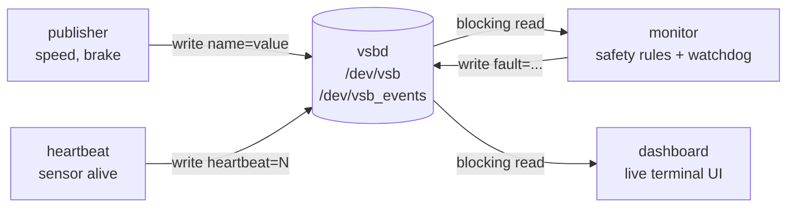

# vsb: a vehicle signal bus for QNX 8.0

`vsb` is a small publish/subscribe bus for vehicle signals (speed, brake, sensor heartbeat), implemented as a **QNX resource manager** in C++. Programs publish values by writing to a device path, subscribers block on another path and are woken when something changes, and a safety monitor watches the signals and raises faults, including when a sensor goes silent.

Built for the **QNX Global Hackathon 2026**, category **Automotive & Mobility**. Runs on QNX 8.0 (aarch64), tested in QEMU.

Demo video: _link to be added_

## Architecture



| Program | Role |
|---|---|
| `vsbd` | The bus. A resource manager that owns the signal table and attaches `/dev/vsb` and `/dev/vsb_events`. |
| `publisher` | Test tool: ramps a signal between two values, e.g. `publisher speed 0 90 50`. |
| `heartbeat` | Simulates a sensor that reports it is alive once per second. |
| `monitor` | Subscriber that evaluates safety rules and publishes the resulting `fault` state. |
| `dashboard` | Subscriber that redraws a live table and a green/red status line. |

### Device interface

- `/dev/vsb`, read: a snapshot of all current signals, one `name=value` per line.
- `/dev/vsb`, write: publish one or more `name=value` lines. Bad input is rejected with an error, and nothing is stored.
- `/dev/vsb_events`, read: **blocks** until something has changed since this subscriber last read, then returns the changed signals. It is a stream, not a poll.

You can use the bus from the shell with no special client:

```
echo "speed=42" > /dev/vsb
cat /dev/vsb
cat /dev/vsb_events      # blocks, prints changes as they happen
```

### Safety rules (monitor)

| Fault | Condition |
|---|---|
| `SENSOR_TIMEOUT` | Heartbeats were seen, then none arrived for 2 s. Highest priority, because every other value is untrustworthy without a live sensor. |
| `OVERSPEED` | `speed` is above 100. |
| `HARD_BRAKE` | `brake` is 3 or more while `speed` is above 50. |
| `OK` | None of the above. |

The monitor publishes its result as the `fault` signal, so the dashboard and any other subscriber see it like any other value.

## QNX features used

- **Resource manager framework** (`resmgr_attach`, `iofunc_*`, `dispatch_*`) with custom read, write and unblock handlers.
- **Deferred replies**: a blocking subscriber read returns `_RESMGR_NOREPLY`, and the server later answers it with `MsgReply()` when data changes. The client stays blocked in the kernel in the meantime, so waiting costs no CPU.
- **Unblock handling**: when a blocked client times out or is signalled, the kernel sends the server an unblock pulse and the server must release the client.
- **`TimerTimeout()`**: the monitor arms a kernel timeout on its blocking read, so it wakes at least every 0.5 s even if no signal changes. This is what makes the sensor watchdog work.
- **QNX message passing** as the transport between all programs.
- **System logger (`slogger2`)**: every fault change is also written to a `vsb` slog2 buffer set, so faults survive in the OS log and can be read with `slog2info -b vsb`.

## Tests

`scripts/run-tests.sh` deploys the build to the running QNX target and executes `scripts/test.sh` there. The test script starts its own `vsbd`, `monitor` and `heartbeat`, drives signals through `/dev/vsb` and checks the published `fault` value. It covers overspeed, hard braking (including the low-speed floor), rejection of bad input, the sensor watchdog, the priority of `SENSOR_TIMEOUT` over other faults, and recovery. It exits non-zero if any check fails. Expected result: `12 passed, 0 failed`.

## Real-time priority demo

QNX schedules strictly by priority, and a server inherits the priority of the client it is serving. `scripts/priority-demo.sh` shows what that buys. The monitor wakes every 0.5 s through a kernel timeout, and `monitor -s` reports how late those wake-ups are. The script measures three cases (typical output from my QEMU run):

| Case | Worst-case wake-up lateness |
|---|---|
| Monitor at priority 10, idle CPU | 4 to 6 ms |
| Monitor at priority 10, 3 CPU hogs running | 14 to 22 ms |
| Monitor at priority 40 (`monitor -s -p 40`), same 3 hogs | about 2 to 3 ms |

Under load the normal-priority monitor competes with the hogs and wakes late. At a higher priority it is not affected by them. Run it on the target with `vsbd` running: `/tmp/priority-demo.sh`.

These are emulated timings (QEMU software emulation on a laptop), so read them as a demonstration of the scheduler's behaviour, not as real-time performance figures for hardware.

## Design notes

- **No lost wake-ups.** Every write bumps a global sequence number, each signal remembers the sequence of its last change, and each subscriber's open file stores the last sequence it has seen. A read replies immediately if there are unseen changes and blocks only otherwise. An earlier version without this showed a real bug: a subscriber could miss an update that arrived between two reads, and the dashboard stayed at OK while the monitor reported HARD_BRAKE.
- **Single-threaded server.** The bus handles one message at a time, so the signal table needs no locks.
- **QNX 8.0 detail worth knowing.** In an unblock handler `ctp->rcvid` is wider than `int`. Comparing it with a stored `int` rcvid silently fails, so the waiter lookup must truncate to `int`. Without this the timed-out reader is never released.
- Through the resource manager a timed-out read surfaces to the client as `EINTR` (errno 4), and the monitor accepts both `EINTR` and `ETIMEDOUT`.

## Build

You need the QNX Software Development Platform 8.0 (free non-commercial licence from QNX). The SDP host tools only run on Linux, so on an Apple Silicon Mac this project uses an x86_64 Ubuntu 22.04 Docker container with the SDP mounted into it.

With the SDP environment loaded (`source ~/qnx800/qnxsdp-env.sh`):

```
./build.sh
```

This cross-compiles all five programs for aarch64 into `build/`. On the Mac setup used for development, `scripts/mac-build.sh` starts the container and runs `build.sh` inside it.

## Run on QNX 8.0 in QEMU

1. Create a QNX aarch64 image with `mkqnximage --type=qemu --arch=aarch64le` (the SDP's image builder, with the QEMU virt BSP and the virtio driver packages installed in QNX Software Center).
2. Boot it: `scripts/run-qemu.sh [image-dir]`. See the comments in that script for why software emulation and virtio-mmio devices are used. Press Ctrl+A then X to quit QEMU. SSH to the guest is forwarded to `localhost:2222`.
3. Copy the programs to the guest: `scripts/deploy.sh` (needs an SSH key at `~/.ssh/qnx_vm`, override with `TARGET_KEY`, `TARGET_HOST`, `TARGET_PORT`).
4. On the guest console start the bus: `/tmp/vsbd &`
5. In SSH sessions to the guest:
   - Session 1: `/tmp/monitor`
   - Session 2: `/tmp/dashboard`
   - Session 3: `/tmp/demo.sh`

`demo.sh` runs a short drive cycle: idle, acceleration, overspeed, recovery, hard braking, then the heartbeat is killed to trigger `SENSOR_TIMEOUT`, then restarted to show recovery. Watch the monitor output and the dashboard status line change.

Afterwards, `slog2info -b vsb` shows the same fault transitions with timestamps, as recorded by the OS logger.

The programs are plain QNX C++ and the build target is aarch64, so the same binaries should run on other aarch64 QNX 8.0 targets such as a Raspberry Pi 5. I have only tested QEMU.

## Limitations

- QEMU runs here in software emulation, so timings show ordering and correctness, not real-time performance figures.
- This is a hackathon prototype, not safety certified code.
- Signal values are integers, and the signal set is open (any valid name can be published) but the safety rules know only `speed`, `brake` and `heartbeat`.

## Licence

MIT. See [LICENSE](LICENSE).
